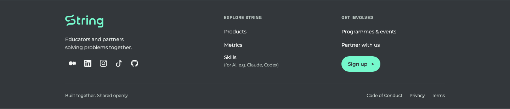
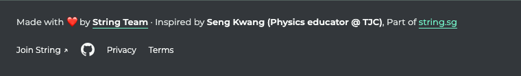
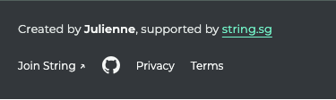

# String footer

Reusable footers for String products and community-built tools. One source, two variants, no runtime downloads or framework dependency.

- **Full:** the ecosystem footer for landing pages, skills and reports. Products → Metrics → Skills; icon socials; Sign up under Get involved; Privacy and Terms. Code of Conduct appears only on String ID.
- **Compact:** visible contributor credits first, then a String backlink, Join String, GitHub and policies. For focused tools and adaptations. Original authors, inspiration and later adapters have separate labels; do not silently replace one with another.

The compact variant follows String's Code of Conduct: name the people behind problem statements, code, writing and other knowledge artefacts in a place people can see. It requires at least one named credit. Preserve their existing credit language and source links. Calling something “inspired by” is different from claiming that person authored this implementation.

## Add it to another app

Requires Node 20+. Clone this repository at a reviewed tag/commit, or install directly from GitHub:

```sh
npm install github:String-sg/string-footer#v1.0.2
```

Use a project-owned `footer.config.json`:

```json
{
  "framework": "react",
  "variant": "compact",
  "componentDir": "src/components/string-footer",
  "credits": [
    {"label": "Original by", "name": "Original contributor", "url": "https://github.com/original-contributor"},
    {"label": "Adapted by", "name": "Your name"}
  ],
  "support": "Part of"
}
```

Replace the example names with verified contributors, then run:

```sh
npx string-footer --config footer.config.json .
npx string-footer --config footer.config.json . --check
```

Import `src/components/string-footer/StringFooter` once after the app's main content. `framework` may be `react`, `astro` or `html`. React/Astro get native source components, not an iframe. Static HTML also needs `pages`, e.g. `["index.html"]`; the tool maintains marked footer regions and a local CSS link. Marked regions are the only HTML it replaces. It does not remove an app's old footer or wire a React/Astro layout automatically. `publicDir` defaults to `public`, `stylePath` to `styles/string-footer.css`, and `componentDir` to `src/components/string-footer`. For plain static files served from the repo root, set `publicDir` to `assets` and copy/serve assets accordingly; the compact variant does not need the logo.

For a full footer, use `"variant": "full"`; `credits` are optional and remain visible when provided. Credit labels/names are escaped; contributor URLs must use HTTPS. String's privacy/terms links describe String services, so independent adopters should review their own policy links before shipping. This package does not grant use of other people's code or replace their licences.

String presets:

```sh
node components/string-footer/sync.mjs landing /path/to/string-sg-landing
node components/string-footer/sync.mjs id /path/to/string-id
node components/string-footer/sync.mjs skills /path/to/str-skills
node components/string-footer/sync.mjs bingo /path/to/bingo-string
node components/string-footer/sync.mjs reports /path/to/reports
node components/string-footer/sync.mjs diagrams /path/to/diagrams
```

Bingo reads “Inspired by Seng Kwang (Physics educator @ TJC), Part of string.sg”, with the name linked to the `sengkwang` String ID profile. Diagrams preserves “Created by Julienne, supported by string.sg”. String ID uses the full footer, credits String Team, and retains its local Code of Conduct link. Game controls, auth, integration links and tool-specific credits remain app-owned. No location label is added.

## Shared assets and updates

The logo is pulled from the canonical [String brand guide](https://github.com/String-sg/string-brand-guide), at the exact commit and SHA-256 recorded in `components/string-footer/brand-assets.lock.json`. Its viewport is cropped; paths and colours are unchanged. Bootstrap social icons retain their MIT licence.

```sh
node scripts/sync-brand-assets.mjs          # explicit network pull from the pinned source
node scripts/sync-brand-assets.mjs --check  # offline digest check
npm test
npm run build
npm pack
```

Consumers commit generated files and `string-footer.json`, including variant, credits and a digest of the rendered HTML, CSS and logo. To update, review a new source tag/commit and rerun the generator. Product builds never fetch a mutable branch or script. For reproducible dependency installs, npm supports Git commit/tag refs in [Git dependencies](https://docs.npmjs.com/cli/v11/configuring-npm/package-json/#git-urls-as-dependencies).

Use this repository's [adoption skill](.claude/skills/string-footer/SKILL.md) for agent-assisted updates. The MIT licence applies to this component's code; brand assets keep their source identity and Bootstrap's notice is retained separately.

## Previews

Full ecosystem footer:



Compact Bingo attribution:



Diagrams on mobile (its exact Julienne credit is preserved):



## Publishing and updating the adoption skill

Edit `.claude/skills/string-footer/` here only. The brand guide links here; the registry and local installs are distribution copies. The skill and footer share the package version. Publication adds a deterministic `release.json` containing the exact source commit and compatible footer version.

### One-time setup

At [String Skills account settings](https://skills.string.sg/account), use the `string` publisher handle to mint a dedicated key with only the `publish` scope. Add it as the repository Actions secret `STRING_SKILLS_PUBLISH_KEY`. This key is handle-scoped by the registry; it is not restricted to this one skill. Do not commit or paste it into issue/PR text.

```sh
gh secret set STRING_SKILLS_PUBLISH_KEY --repo String-sg/string-footer
```

The command prompts for the key without placing it in shell history. Repository maintainers should restrict tag creation and review publishing-workflow changes because tagged releases can use this secret.

### Release

1. Update the skill/component in one PR, bump `package.json` (the generator reads its manifest version from there) when creating a new release, and run `npm test` plus the existing build/asset checks.
2. Merge the reviewed PR, then tag that commit `v<package.json version>` and push the tag. `Publish footer skill` validates the release, publishes `string/string-footer`, and verifies every manifest digest and downloaded file. A green workflow means the registry bytes match the tag.
3. If publication fails, fix the cause and rerun using the workflow's **Run workflow** action with the same tag. An identical existing version is verified without rewriting it. Different content, extra files, yanked versions and registry failures fail the run; never move an existing tag or overwrite an immutable version. Publish a new version for changes.

For the initial registry publication, merge this change and create `v1.0.3` at the merged commit after configuring the secret. If the secret is added after the tag, run the workflow manually with `v1.0.3`.

Local dry run / read-only verification (the commit must be the release tag's full SHA):

```sh
RELEASE_COMMIT=$(git rev-parse HEAD) node scripts/publish-skill.mjs --dry-run
RELEASE_COMMIT=$(git rev-parse HEAD) node scripts/publish-skill.mjs --verify-only
```

### Update installations and products explicitly

Installed skills are snapshots, not live subscriptions. For a local Codex or Claude installation, obtain the desired tagged repository, replace the installed `string-footer` skill folder from that tag, and compare its files with that tag before using it. Keep local custom guidance outside the generated folder. Registry downloads also include `release.json`, which identifies the compatible footer checkout. The registry's existing one-way GitHub mirror handles its public distribution; do not edit the mirror.

Product footers update separately through reviewed PRs: regenerate with the chosen release and run `sync.mjs <product> <checkout> --check`. This detects local drift relative to that release, not whether a newer release exists. A footer release does not deploy changes to consumer sites.

## Creator profiles and school visibility

Compact credits default to “Created by …, supported by string.sg”. Bingo is the exception: at the owner's request it reads “Inspired by Seng Kwang (Physics educator @ TJC), Part of string.sg”, linked to the `sengkwang` String ID profile. The heart wording and String Team credit are removed.

A credit may include `creation: "bingo"` (or `"diagrams"`). The generator bundles a local, optional enhancement that requests public attribution from `https://id.string.sg/api/creation?slug=…`, without cookies or caching. The response links to the creator's public String ID profile and includes a school only when its existing `showSchool` checkbox and public profile permit it. Do not place a school directly in static credit text. The one exception is Bingo's owner-approved “@ TJC”, which matches the school Seng Kwang's public profile showed on 9 November 2026; Bingo does not use the lookup. If that profile stops showing the school, remove it from the `bingo` preset and from Bingo's `footer.config.json`. If the API is unavailable, the approved original credit remains and no school is shown. This is a public profile display preference, not school-affiliation verification.

The reviewed mapping lives in String ID's `src/lib/creations.ts`; the same mapping populates Profile → My creations and public profile pages. Handles must be confirmed before assigning them. Bingo links to the confirmed Seng Kwang profile. Diagrams links to Julienne’s confirmed `jtan` profile. The module bundles locally; it never fetches executable code from GitHub. Sites with a Content Security Policy must allow `https://id.string.sg` in `connect-src`. This enhancement requires the String ID API change to deploy first; products work with their fallback credits beforehand.
