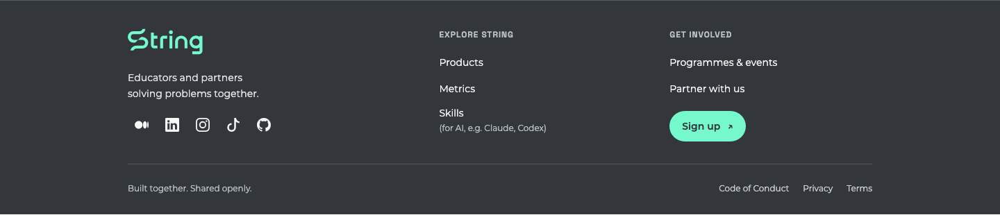
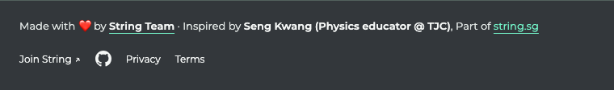
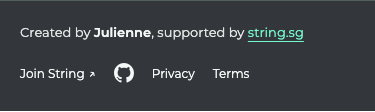

# String footer

Reusable footers for String products and community-built tools. One source, two variants, no runtime downloads or framework dependency.

- **Full:** the ecosystem footer for landing pages, skills and reports. Products → Metrics → Skills; icon socials; Sign up under Get involved; Privacy and Terms. Code of Conduct appears only on String ID.
- **Compact:** visible contributor credits first, then a String backlink, Join String, GitHub and policies. For focused tools and adaptations. Original authors, inspiration and later adapters have separate labels; do not silently replace one with another.

The compact variant follows String's Code of Conduct: name the people behind problem statements, code, writing and other knowledge artefacts in a place people can see. It requires at least one named credit. Preserve their existing credit language and source links. Calling something “inspired by” is different from claiming that person authored this implementation.

## Add it to another app

Requires Node 20+. Clone this repository at a reviewed tag/commit, or install directly from GitHub:

```sh
npm install github:String-sg/string-footer#v1.0.2
```

Use a project-owned `footer.config.json`:

```json
{
  "framework": "react",
  "variant": "compact",
  "componentDir": "src/components/string-footer",
  "credits": [
    {"label": "Original by", "name": "Original contributor", "url": "https://github.com/original-contributor"},
    {"label": "Adapted by", "name": "Your name"}
  ],
  "support": "Part of"
}
```

Replace the example names with verified contributors, then run:

```sh
npx string-footer --config footer.config.json .
npx string-footer --config footer.config.json . --check
```

Import `src/components/string-footer/StringFooter` once after the app's main content. `framework` may be `react`, `astro` or `html`. React/Astro get native source components, not an iframe. Static HTML also needs `pages`, e.g. `["index.html"]`; the tool maintains marked footer regions and a local CSS link. Marked regions are the only HTML it replaces. It does not remove an app's old footer or wire a React/Astro layout automatically. `publicDir` defaults to `public`, `stylePath` to `styles/string-footer.css`, and `componentDir` to `src/components/string-footer`. For plain static files served from the repo root, set `publicDir` to `assets` and copy/serve assets accordingly; the compact variant does not need the logo.

For a full footer, use `"variant": "full"`; `credits` are optional and remain visible when provided. Credit labels/names are escaped; contributor URLs must use HTTPS. String's privacy/terms links describe String services, so independent adopters should review their own policy links before shipping. This package does not grant use of other people's code or replace their licences.

String presets:

```sh
node components/string-footer/sync.mjs landing /path/to/string-sg-landing
node components/string-footer/sync.mjs id /path/to/string-id
node components/string-footer/sync.mjs skills /path/to/str-skills
node components/string-footer/sync.mjs bingo /path/to/bingo-string
node components/string-footer/sync.mjs reports /path/to/reports
node components/string-footer/sync.mjs diagrams /path/to/diagrams
```

Bingo's compact variant preserves “Made with ❤️ by String Team” and “Inspired by Seng Kwang (Physics educator @ TJC)”. Diagrams preserves “Created by Julienne, supported by string.sg”. String ID also uses compact, credits String Team, and retains its local Code of Conduct link. Game controls, auth, integration links and tool-specific credits remain app-owned. No location label is added.

## Shared assets and updates

The logo is pulled from the canonical [String brand guide](https://github.com/String-sg/string-brand-guide), at the exact commit and SHA-256 recorded in `components/string-footer/brand-assets.lock.json`. Its viewport is cropped; paths and colours are unchanged. Bootstrap social icons retain their MIT licence.

```sh
node scripts/sync-brand-assets.mjs          # explicit network pull from the pinned source
node scripts/sync-brand-assets.mjs --check  # offline digest check
npm test
npm run build
npm pack
```

Consumers commit generated files and `string-footer.json`, including variant, credits and a digest of the rendered HTML, CSS and logo. To update, review a new source tag/commit and rerun the generator. Product builds never fetch a mutable branch or script. For reproducible dependency installs, npm supports Git commit/tag refs in [Git dependencies](https://docs.npmjs.com/cli/v11/configuring-npm/package-json/#git-urls-as-dependencies).

Use this repository's [adoption skill](.claude/skills/string-footer/SKILL.md) for agent-assisted updates. The MIT licence applies to this component's code; brand assets keep their source identity and Bootstrap's notice is retained separately.

## Previews

Full ecosystem footer:



Compact Bingo attribution (its inspiration credit is preserved):



Diagrams on mobile (its exact Julienne credit is preserved):


